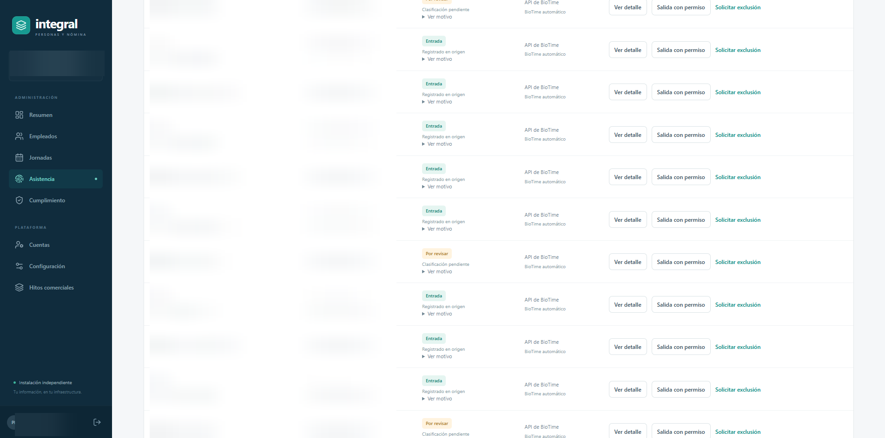
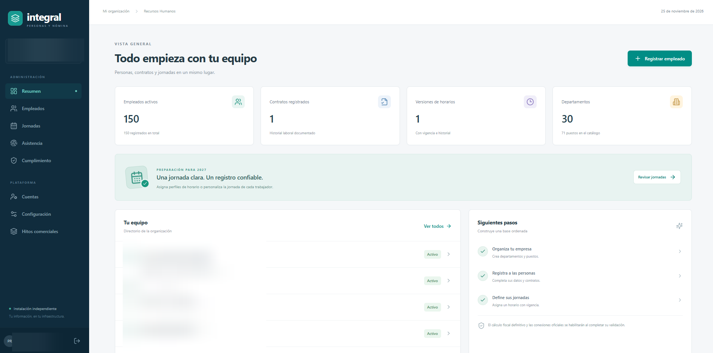
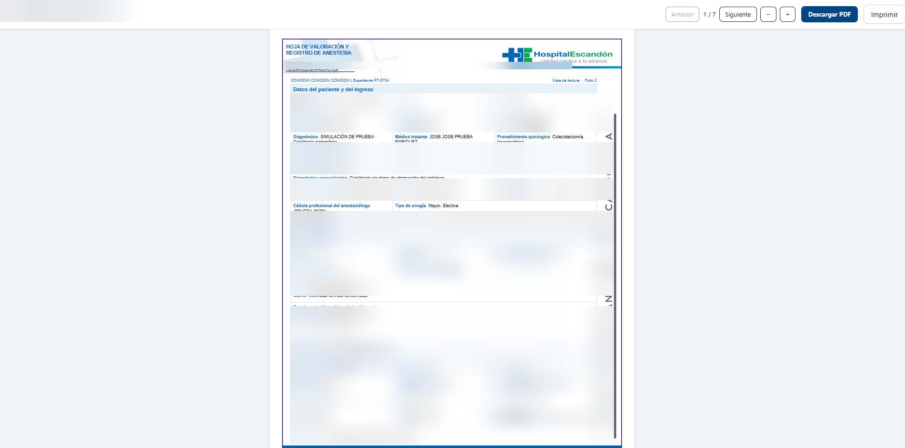
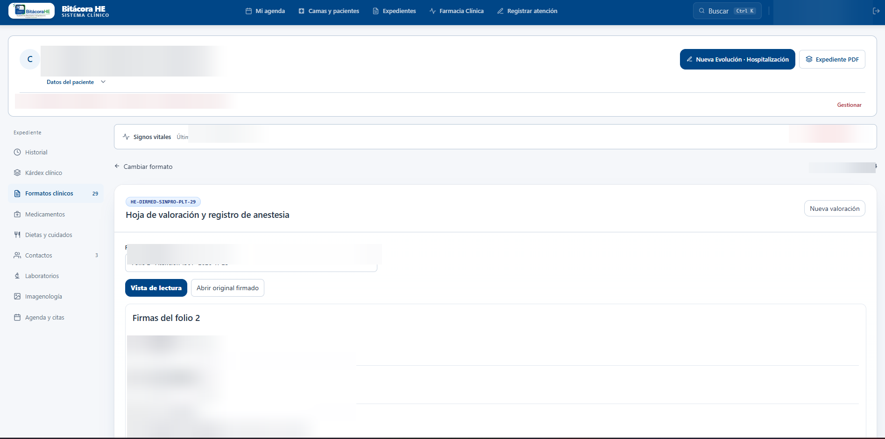
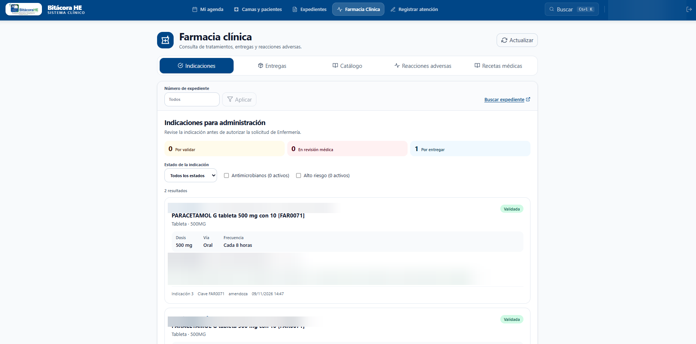
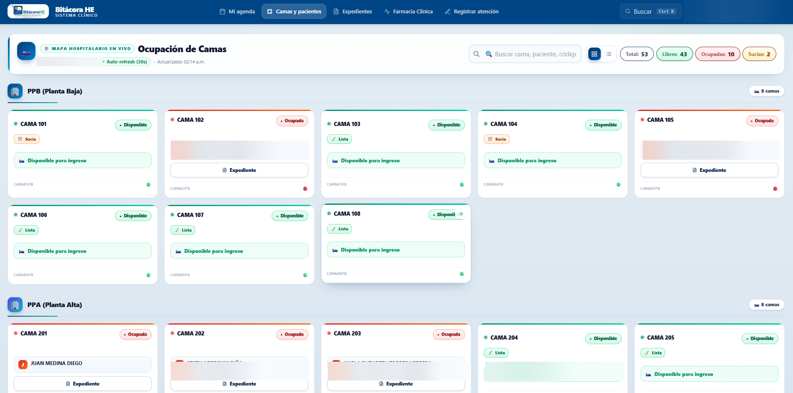
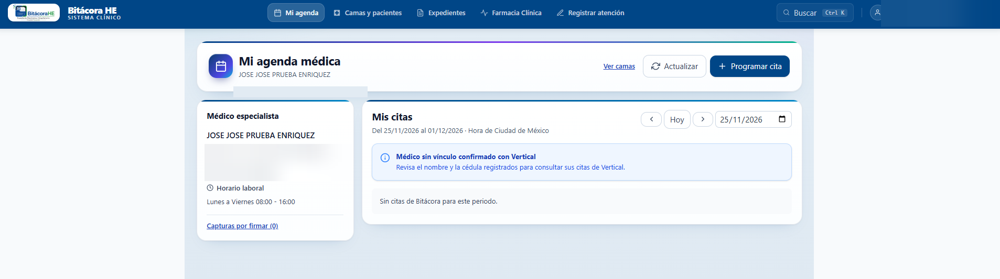
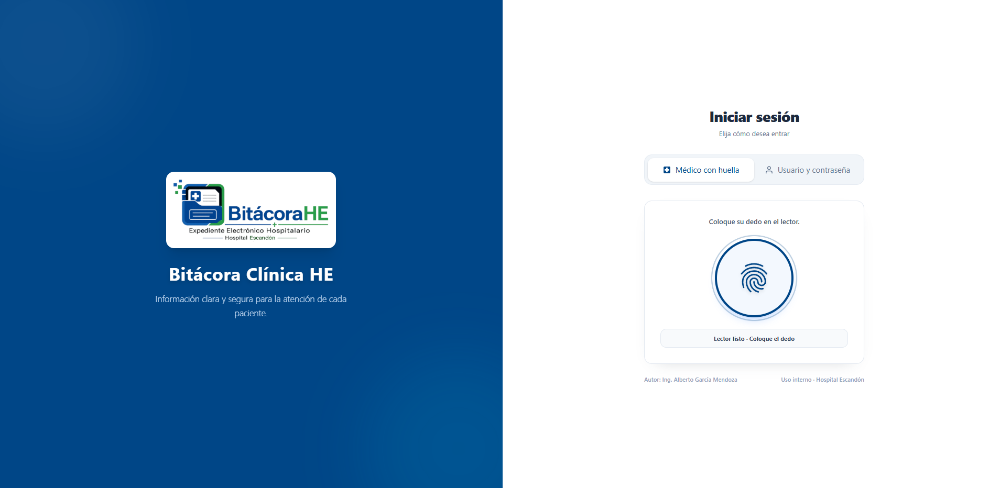
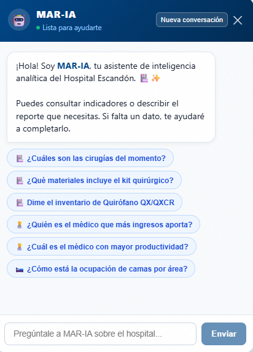
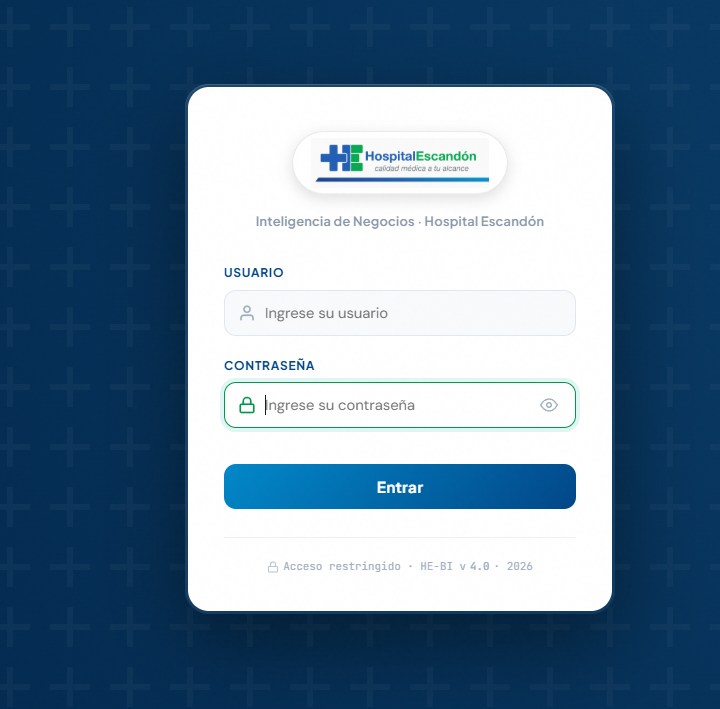

<h1 align="center">Alberto García Mendoza</h1>

<h3 align="center">
Ingeniero en Sistemas Computacionales | Desarrollador de Software
</h3>

Desarrollo de soluciones tecnológicas para la transformación digital empresarial.

---

## 🚀 Servicios profesionales

- Desarrollo de páginas web y catálogos digitales.
- Software empresarial a medida.
- Control de asistencia y gestión de personal.
- Business Intelligence y análisis de datos.
- Automatización de procesos.
- Infraestructura de redes y seguridad informática.
- Integración de sistemas y bases de datos.

---

## 💼 Portafolio de proyectos

### Integral Nómina — Gestión empresarial

Plataforma orientada a la digitalización y administración de recursos humanos, control de asistencia y gestión de jornadas laborales.

**Funcionalidades principales:**

- Administración de empleados.
- Control de asistencia.
- Gestión de horarios y turnos.
- Control de incidencias.
- Reportes administrativos.
- Gestión de usuarios y permisos.

### Galería de la plataforma

  
  

  
  

<b>📸 Ver más capturas de la plataforma</b>

 

  
  
  
  
  
  
  
  
  
  
  
  
  

---

## 💻 Otros proyectos desarrollados

| Proyecto | Descripción |
|---|---|
| Bitácora Médica | Gestión del expediente médico electrónico. |
| HE-BI | Inteligencia de negocios e indicadores ejecutivos. |
| Bio-Security | Autenticación y validación biométrica. |
| DataGuard Pro | Protección de datos. |
| Resguardos HE | Gestión y control de equipos. |
| BI-Cleaner | Procesamiento y limpieza de datos. |
| Históricos | Consulta y gestión de información histórica. |

---

## 🛠️ Tecnologías

---

## 🔒 Privacidad y propiedad intelectual

El código fuente de las soluciones empresariales permanece privado.

Este portafolio tiene fines exclusivamente demostrativos y comerciales.

---

## 🤝 Contacto y proyectos

Disponible para proyectos de desarrollo de software, diseño web, automatización y consultoría tecnológica.

**Cotizaciones personalizadas y demostraciones previa solicitud.**
