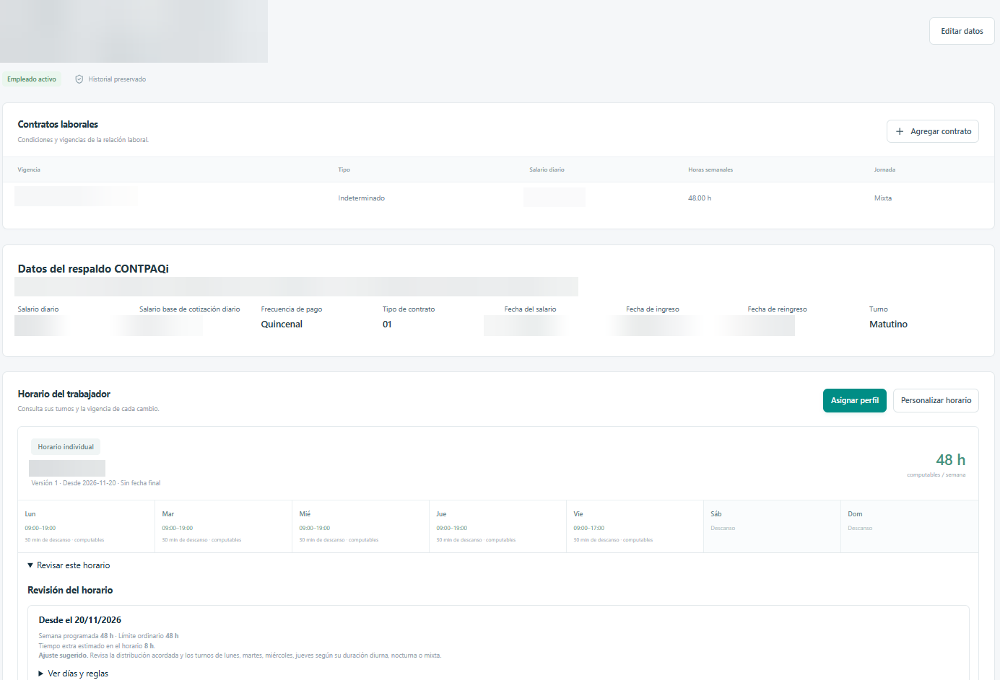
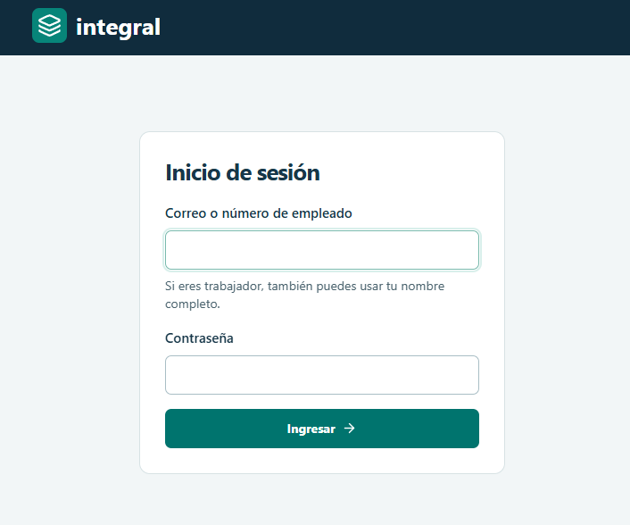
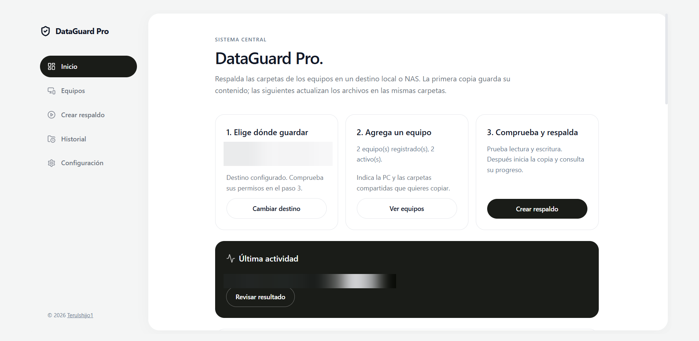
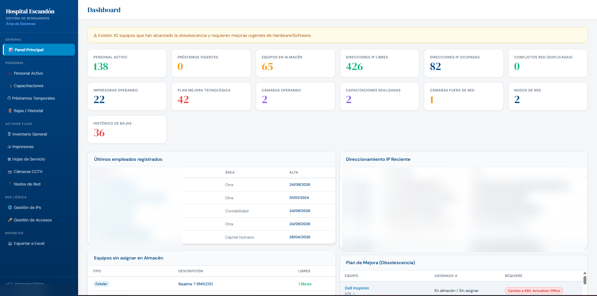
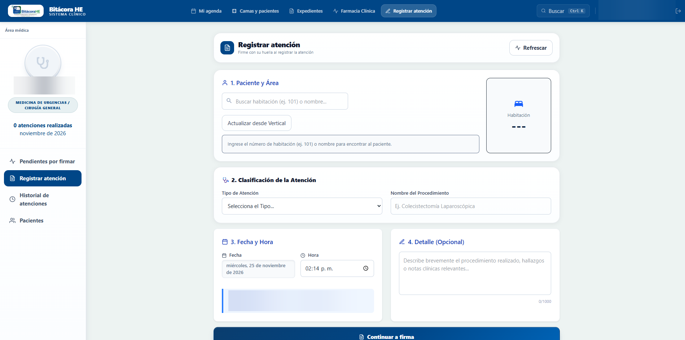
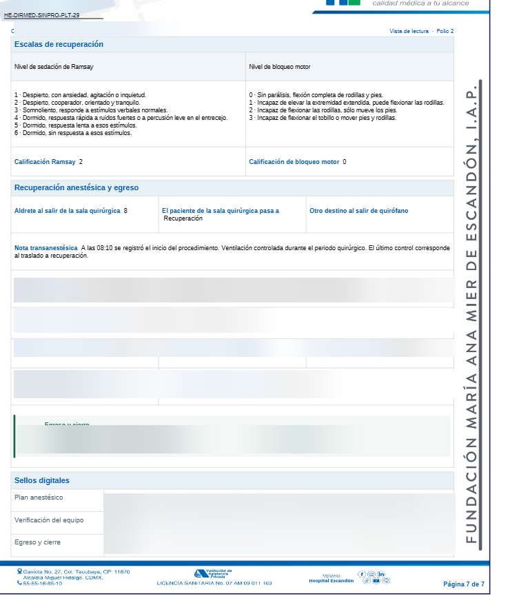
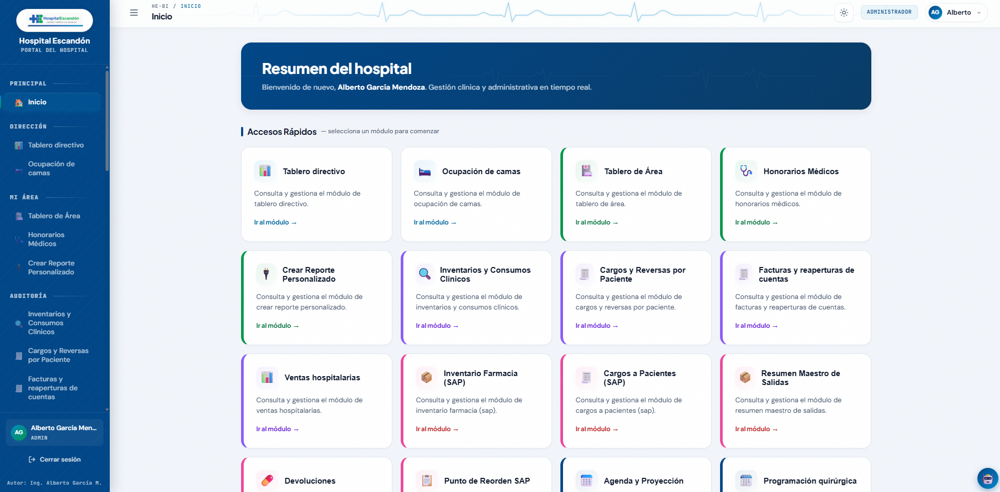

<h1 align="center">Alberto García Mendoza</h1>

<h3 align="center">
Ingeniero en Sistemas Computacionales | Desarrollador de Software
</h3>

Ingeniería, innovación y desarrollo de soluciones tecnológicas para la transformación digital empresarial.

  
  
  

---

## 🚀 Servicios profesionales

- Desarrollo de páginas web y catálogos digitales.
- Desarrollo de software empresarial a medida.
- Sistemas de control de asistencia y gestión de personal.
- Business Intelligence y análisis de datos.
- Automatización de procesos empresariales.
- Infraestructura de redes y soluciones informáticas.
- Integración de sistemas y bases de datos.
- Soluciones de autenticación biométrica.

---

# 💼 Portafolio de proyectos

## 01 | Integral Nómina

### Plataforma integral de gestión empresarial

Solución tecnológica orientada a la digitalización de los procesos de recursos humanos, administración de personal y control de asistencia.

**Funcionalidades principales:**

- Administración de empleados.
- Control de entradas y salidas.
- Gestión de horarios y jornadas laborales.
- Control de incidencias y horas extra.
- Reportes administrativos.
- Gestión de usuarios, roles y permisos.

  

  
  

  

---

## 02 | DataGuard Pro

### Protección y gestión de datos

Solución informática orientada a la protección y gestión de información digital.

  

---

## 03 | Plataforma de Resguardos

### Gestión y control de activos tecnológicos

Sistema orientado a la administración de equipos informáticos y resguardos institucionales, facilitando la organización y trazabilidad de los recursos tecnológicos.

  

---

## 04 | Bitácora Médica

### Plataforma de expediente médico electrónico

Solución tecnológica orientada a la digitalización de procesos clínicos, administración de información médica y registro de procedimientos.

**Funcionalidades principales:**

- Gestión de expedientes médicos.
- Registro de procedimientos clínicos.
- Digitalización de formatos médicos.
- Autenticación y firma biométrica.
- Administración de usuarios y permisos.
- Integración con sistemas hospitalarios.
- Mecanismos de integridad documental.

  

  
  

<b>📸 Ver galería completa de Bitácora Médica</b>

 

  

  
  

  
  

---

## 05 | Business Intelligence — HE-BI

### Inteligencia de negocios y análisis de datos

Plataforma orientada a transformar información operativa en indicadores estratégicos para facilitar la toma de decisiones.

**Funcionalidades principales:**

- Dashboards interactivos.
- Indicadores de desempeño.
- Visualización y análisis de datos.
- Filtros y consultas dinámicas.
- Exportación de información.
- Administración de usuarios y permisos.
- Integración con bases de datos.

  

  
  

---

## 📂 Otros desarrollos

| Proyecto | Descripción |
|---|---|
| Bio-Security | Autenticación y validación biométrica. |
| BI-Cleaner | Procesamiento y limpieza de datos. |
| Históricos | Consulta y administración de información histórica. |

---

## 🛠️ Tecnologías y herramientas

### Desarrollo de software

### Bases de datos

### Business Intelligence e infraestructura

---

## 🔒 Privacidad y seguridad

El código fuente de las soluciones empresariales permanece en repositorios privados.

Las imágenes de este portafolio tienen fines demostrativos. Las demostraciones de plataformas institucionales están sujetas a autorización.

---

## 🤝 Colaboraciones y proyectos

Disponible para proyectos de:

- Desarrollo web.
- Software empresarial personalizado.
- Digitalización de procesos.
- Automatización.
- Consultoría tecnológica.
- Inteligencia de negocios.
- Infraestructura informática.

  <b>Soluciones tecnológicas adaptadas a las necesidades de cada empresa.</b>

  Cotizaciones personalizadas y demostraciones previa solicitud.

